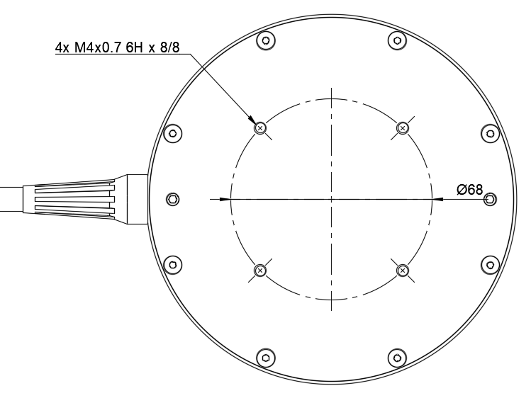

# DVL A125

[Buy DVL A125 here](https://waterlinked.com/product/dvl-a125/)

## Description
The [DVL A125](https://www.waterlinked.com/dvl/dvl-a125) is the next step up from the [DVL A50](https://www.waterlinked.com/dvl/dvl-a50), providing better performance at greater distances while still keeping a small form factor relative to competing DVLs.

The DVL A125 builds on the DVL A50 with increased performance, a small 4-beam setup, an open interface protocol, and mid-to-low cost.

!!! tip
    Keep the DVL A125 in a bucket of water to ensure sufficient cooling when using the DVL on a workbench.

## Dimensions

### Cable dimensions
Delivered cable length: 3.0 m

Cable diameter: 7.8 mm +/- 0.2 mm

## Mounting holes

## Transducer numbering

Mechanical drawings number the transducers from 1 to 4. Protocol messages and diagnostic logs use zero-based transducer `id` values from 0 to 3. See [Transducer numbering and protocol IDs](axes.md#transducer-numbering-and-protocol-ids).

## Transducer beam width

Half-power beam width is 4.1°

## Line of sight

Keep a 65° cone below the transducers free of obstructions. The cone starts at the outer edge of the housing face, and the drawing is to scale.

<svg xmlns="http://www.w3.org/2000/svg" viewBox="0 0 680 420" fill="currentColor" font-size="12" style="max-width: 680px;" role="img" aria-label="DVL A125 line of sight, side view: keep a 65 degree cone below the transducers free">
  <defs><marker id="los-dvla125-a" markerWidth="6" markerHeight="6" refX="5" refY="3" orient="auto"><path d="M0,0 L6,3 L0,6 Z"/></marker><marker id="los-dvla125-b" markerWidth="6" markerHeight="6" refX="1" refY="3" orient="auto"><path d="M6,0 L0,3 L6,6 Z"/></marker></defs>
  <text x="20" y="24" font-size="14" font-weight="bold">DVL A125 line of sight (side view)</text>
  <text x="20" y="42" font-size="11" opacity="0.75">Mounting side up, transducers facing the seabed. Drawn to scale against the other DVL models.</text>
  <polygon points="240.0,113.2 440.0,113.2 610.0,380.0 70.0,380.0" fill="currentColor" fill-opacity="0.07" stroke="none"/>
  <line x1="240.0" y1="113.2" x2="70.0" y2="380.0" stroke="currentColor" stroke-width="1.4"/>
  <line x1="440.0" y1="113.2" x2="610.0" y2="380.0" stroke="currentColor" stroke-width="1.4"/>
  <path d="M166.8,228.1 A322.4,322.4 0 0 0 513.2,228.1" fill="none" stroke="currentColor" stroke-width="0.8" marker-start="url(#los-dvla125-a)" marker-end="url(#los-dvla125-b)"/>
  <text x="340" y="296.6" text-anchor="middle" font-size="13" font-weight="bold">65°</text>
  <text x="340" y="402.0" text-anchor="middle" font-size="11">Keep this 65° cone free of brackets, frames, cables, thrusters and hull</text>
  <g stroke="currentColor" stroke-width="0.9" stroke-dasharray="5 4" opacity="0.8">
    <line x1="412.5" y1="124.6" x2="490.7" y2="313.4"/>
    <line x1="267.5" y1="124.6" x2="189.3" y2="313.4"/>
    <line x1="412.5" y1="124.6" x2="412.5" y2="184.6" stroke-dasharray="2 3"/>
  </g>
  <path d="M412.5,170.6 A46,46 0 0 0 430.1,167.1" fill="none" stroke="currentColor" stroke-width="0.8"/>
  <text x="436.5" y="188.6" font-size="11">22.5°</text>
  <text x="500.7" y="315.4" font-size="11" opacity="0.85">Beam axis</text>
  <path d="M240.0,88.0 L440.0,88.0 L440.0,113.2 L385.0,136.0 L295.0,136.0 L240.0,113.2 Z" fill="currentColor" fill-opacity="0.18" stroke="currentColor" stroke-width="1.6" stroke-linejoin="round"/>
  <g stroke="currentColor" stroke-width="3.2" stroke-linecap="round">
    <line x1="433.4" y1="116.0" x2="391.6" y2="133.3"/>
    <line x1="246.6" y1="116.0" x2="288.4" y2="133.3"/>
  </g>
  <line x1="240.0" y1="76.0" x2="440.0" y2="76.0" stroke="currentColor" stroke-width="0.7" marker-start="url(#los-dvla125-b)" marker-end="url(#los-dvla125-a)"/>
  <text x="340" y="71.0" text-anchor="middle" font-size="11">Ø125 mm</text>
  <line x1="454.0" y1="88.0" x2="454.0" y2="136.0" stroke="currentColor" stroke-width="0.7" marker-start="url(#los-dvla125-b)" marker-end="url(#los-dvla125-a)"/>
  <text x="460.0" y="116.0" font-size="11">30 mm</text>
  <text x="230.0" y="100.0" text-anchor="end" font-size="11" opacity="0.85">Mounting side</text>
  <text x="213.5" y="140.0" text-anchor="end" font-size="11" opacity="0.85">Transducers</text>
</svg>

## Datasheet

[Datasheet](https://waterlinked.com/dvl-a125#Downloads-%2F-Resources%E2%80%8B)
