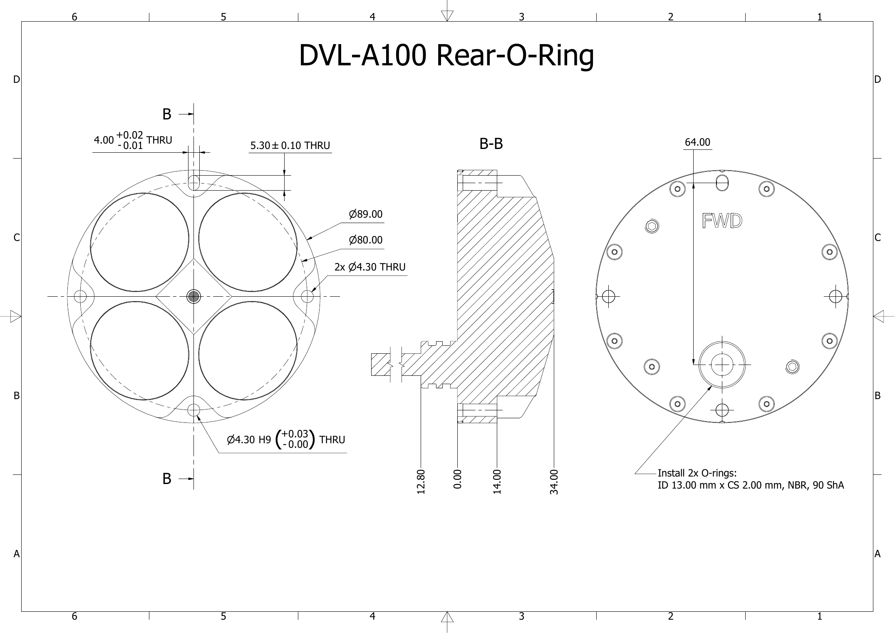
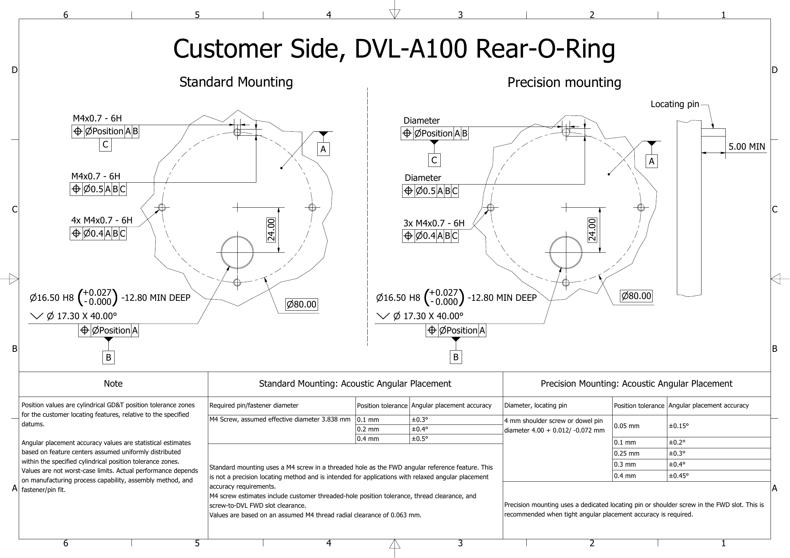

# DVL A100 rear O-ring mounting

This page describes how to mount the DVL A100 rear O-ring interface version on a vehicle. It covers the mounting interface you need to machine, how to choose between standard and precision mounting, the installation steps, and how to maintain the seal.

On this version the cable leaves the DVL through a piston seal plug in the back plate. The plug carries two O-rings that seal in a bore in your vehicle, so the cable passes straight into the dry space of the vehicle. The rear O-ring interface version is rated to 1,000 m.

!!! info "Applies to the rear O-ring interface version only"
    The side cable entry version is mounted with three Ø4.30 mm through holes on a Ø80 mm bolt circle and is not covered here. See [DVL A100](../dvl-a100.md).

!!! warning "The O-rings seal your vehicle"
    The two O-rings on the piston seal plug are what keeps seawater out of your vehicle at this point. A scratched bore or a nicked O-ring lets seawater into the vehicle.

## How the rear interface works

Two features locate the DVL on the vehicle. The piston seal plug fixes its position on the mounting face, and a pin or screw in the FWD slot fixes its rotation. The three remaining holes only clamp the DVL.

| Feature | Description |
| --- | --- |
| Piston seal plug | Ø16.50 mm plug fixed in the stainless steel back plate, on the DVL front/back centerline, 64.00 mm from the FWD slot. Its two O-rings center it in the vehicle bore and seal against seawater. The cable runs through its middle. |
| FWD slot | On the Ø80.00 mm bolt circle, on the side marked FWD on the back plate. The slot is 4.00 mm +0.02 / -0.01 wide, which is 3.99 to 4.02 mm, and 5.30 ± 0.10 mm long in the direction of the plug. The extra length lets the pin control rotation without fighting the plug. |
| Back hole | Ø4.30 mm H9 through hole on the bolt circle, opposite the FWD slot. Used as a clearance hole for an M4 screw. |
| Left and right holes | 2x Ø4.30 mm through holes on the bolt circle. Used as clearance holes for M4 screws. |

All four bolt circle features sit in pockets at the rim of the housing, between the transducers. The screws go in from the transducer side.

The x axis of the DVL points from the center toward the FWD slot, y points right and z points down toward the seabed. See [Axes](../axes.md).

## Choose standard or precision mounting

The DVL measures velocity along its own axes. If those axes are turned relative to the vehicle, straight travel shows up partly as sideways motion, and dead reckoning drifts sideways. A 0.1° error adds about 1.7 m of sideways error per kilometre travelled, and 0.4° adds about 7 m.

A known rotation can be compensated with the mounting rotation offset, see [Axes](../axes.md). The offset is a floating point value, so a measured offset such as 0.25° can be entered as it is. A rotation that comes from clearance and position tolerances in the mounting interface is unknown and cannot be compensated. The angular placement accuracy values below are an estimate of this unknown rotation for a given quality of the customer mounting features.

* **Precision mounting** uses a locating pin or shoulder screw in the FWD slot. Use it when the beams must line up with the vehicle forward axis within ±0.15° to ±0.45°.
* **Standard mounting** uses an M4 screw in the FWD slot. It needs no special parts and gives ±0.3° to ±0.5°.

The DVL A100 has a smaller bolt circle and a shorter distance between the plug and the FWD slot than the DVL A250, so the same position tolerances give a slightly larger angular error.

| Mounting | Part in the FWD slot | Position tolerance of bore and FWD feature | Angular placement accuracy |
| --- | --- | --- | --- |
| Precision | 4 mm shoulder screw or dowel pin, Ø4.00 mm +0.012 / -0.072 | Ø0.05 mm | ±0.15° |
| Precision | 4 mm shoulder screw or dowel pin, Ø4.00 mm +0.012 / -0.072 | Ø0.10 mm | ±0.2° |
| Precision | 4 mm shoulder screw or dowel pin, Ø4.00 mm +0.012 / -0.072 | Ø0.25 mm | ±0.3° |
| Precision | 4 mm shoulder screw or dowel pin, Ø4.00 mm +0.012 / -0.072 | Ø0.30 mm | ±0.4° |
| Precision | 4 mm shoulder screw or dowel pin, Ø4.00 mm +0.012 / -0.072 | Ø0.40 mm | ±0.45° |
| Standard | M4 screw in an M4x0.7 - 6H thread | Ø0.10 mm | ±0.3° |
| Standard | M4 screw in an M4x0.7 - 6H thread | Ø0.20 mm | ±0.4° |
| Standard | M4 screw in an M4x0.7 - 6H thread | Ø0.40 mm | ±0.5° |

The position tolerance is a cylindrical GD&T position tolerance zone and applies to both the plug bore and the FWD feature. With both features inside the stated zone, the tolerance model predicts 7 or fewer installations per million outside the stated angle. These are statistical estimates, not worst-case limits. See [How the accuracy values are derived](#how-the-accuracy-values-are-derived).

### Locating pin for precision mounting

* Diameter Ø4.00 mm +0.012 / -0.072 mm, which is 3.928 to 4.012 mm. A 4 mm shoulder screw or a 4 mm dowel pin is within this range.
* The pin must protrude at least 5.00 mm from the mounting face so that it engages the full depth of the FWD slot.
* Make the pin or shoulder screw from a seawater-resistant material such as A4 or 316 stainless steel. Standard gauge pins and many dowel pins are tool steel and rust in seawater.

!!! warning "A dowel pin is a tight fit and may not enter the slot"
    The FWD slot is 3.99 to 4.02 mm wide. With this locating method the pin has to be this close to the slot width to reach the stated accuracy, so the fit is tight by design. A 4 mm m6 dowel pin, 4.004 to 4.012 mm, is wider than the smallest slot and may not enter it. A 4 mm shoulder screw is normally made below nominal and fits.

    If a dowel pin will not go in at all, sand or polish it down lightly and evenly until it just enters the slot. Keep the pin round and do not take off more than needed. The fit will still be tight. Do not file or widen the slot in the DVL.

## Machine the vehicle mounting interface

Machine the mounting face to the customer side drawing above, which shows a standard and a precision version. The drawing uses the mounting face as datum A, the plug bore as datum B and the FWD feature as datum C.

| Feature | Requirement |
| --- | --- |
| Mounting face, datum A | Flat and clean under the whole back plate, so the back plate seats all the way round the bolt circle. |
| Plug bore, datum B | Ø16.50 mm H8, which is 16.500 to 16.527 mm. At least 12.80 mm deep. Ø17.30 mm x 40° countersink at the face as a lead-in for the O-rings. Position tolerance from the table above, relative to A. |
| FWD feature, datum C | On the Ø80.00 mm bolt circle, 64.00 mm from the bore center. Precision mounting: a hole for the locating pin or a thread for the shoulder screw. Standard mounting: an M4x0.7 - 6H thread. Position tolerance from the table above, relative to A and B. A Ø0.5 mm position tolerance to A, B, C also applies to this feature. |
| Back and side holes | 3x M4x0.7 - 6H on the Ø80.00 mm bolt circle, at 90° spacing from the FWD feature. Position tolerance Ø0.4 mm to A, B, C. |
| Cable passage | From the bottom of the bore into the dry space. Large enough for the 7.8 ± 0.2 mm cable, with both ends deburred and rounded so they cannot cut the jacket. |

The bolt circle center is 24.00 mm forward of the bore center, on the front/back centerline.

The bore wall and countersink are sealing surfaces. Keep them free of scratches, chatter marks and burrs. A scratch along the bore axis gives water a path past both O-rings.

If the mounting plate is aluminium, anodise it, including the bore, and machine the bore so it is within H8 after anodising. The back plate is 316 stainless steel, and bare aluminium in contact with it corrodes in seawater.

<!-- TODO: Engineering review: confirm the 12.80 mm minimum bore depth still holds if the piston seal length changes. Add surface finish for the bore and flatness for the mounting face if the drawing lacks them. -->

## Parts and tools

* DVL A100 with rear O-ring interface. The plug carries two O-rings, ID 13.00 mm x CS 2.00 mm, NBR, 90 Shore A.
* M4 screws in A4 stainless steel. Standard mounting takes 4 screws, precision mounting takes 3. Choose the length from the DVL flange thickness plus the thread depth in your plate.
* For precision mounting, a locating pin or shoulder screw as specified above.
* Silicone O-ring grease that is compatible with NBR.
* Isopropyl alcohol and lint-free wipes.
* Spare O-rings of the same specification.
* A hex key or bit for your screws, and a torque wrench.
* A clamp or cable ties to relieve strain on the cable inside the vehicle.

## Install the DVL

Seat the plug by hand first, then clamp the DVL with the screws. Never use the screws to pull the plug into the bore.

1. Clean the bore, the countersink and the mounting face with isopropyl alcohol. Check them for scratches and burrs, and blow any chips out of the cable passage.
2. For precision mounting with a locating pin, fit the pin in the vehicle plate now. A shoulder screw goes in at step 9.
3. Inspect both O-rings on the plug. They must sit square in their grooves with no cuts, flat spots or twists. Replace a damaged O-ring before you go on.
4. Apply a thin film of silicone grease to both O-rings and to the countersink. The O-rings should look wet, without lumps of grease.
5. Feed the cable through the bore and the cable passage into the vehicle. Fit a connector to the cable end only after the cable is through. Do not let the DVL hang by its cable.
6. Turn the DVL so the FWD mark on the back plate points at the FWD feature on the vehicle.
7. Push the plug straight into the bore without twisting, with the back plate parallel to the mounting face. Take up the cable slack from inside the vehicle as the DVL goes in. In precision mounting the locating pin enters the FWD slot at the same time.
8. Check that the back plate sits flat on the mounting face. If the DVL stops before that, pull it out and check the O-rings and the countersink.
9. Fit the screws from the transducer side: M4 screws in the back and side holes, and, unless you use a locating pin, the M4 screw or shoulder screw in the FWD slot.
10. Hold the DVL still and tighten the screws in a cross pattern, in two passes.
11. Clamp the cable inside the vehicle close to the passage, so a pull on the cable does not reach the plug. Avoid sharp bends where the cable leaves the passage.

<!-- TODO: Engineering review: add tightening torque and recommended screw length for the M4 screws. -->

## Check and configure

Before the first dive, test the seal from inside the vehicle and set the mounting rotation of the DVL.

* Check that every screw is tight and that the back plate has no gap to the mounting face.
* If the vehicle housing has a vacuum test port, run your normal vacuum test with the DVL fitted. The vacuum loads the plug O-rings in the same direction as water pressure does.
* In the DVL web GUI, leave the mounting rotation offset at 0 if the FWD feature lies on the vehicle forward axis. If you placed it at another angle, enter that angle. See [Axes](../axes.md).
* If a navigation system uses the DVL velocity, enter the measurement point of the DVL as its position. On the DVL A100 it lies on the central axis, 38 mm above the back plate, so inside the vehicle. See [Origin](../axes.md#origin).
* Do the first water test as described in [Installation](installation.md#first-water-test).

## Remove the DVL and maintain the seal

Inspect the O-rings every time the plug comes out of the bore, and fit only 90 Shore A replacements.

* To remove the DVL, take out all screws. Pull the DVL straight out of the bore while you feed the cable back from inside. Do not pull on the cable or lever against the transducer face.
* Replace both O-rings if either one has a cut, a flat spot or a twist.
* Use ID 13.00 mm x CS 2.00 mm NBR O-rings in 90 Shore A. The same size in 70 Shore A holds only to 600 m, not the full 1,000 m rating.
* Fit new O-rings with your fingers. A metal pick or screwdriver can nick them or scratch the grooves.
* After use in seawater, rinse the DVL and the mounting interface with fresh water. Before you refit the DVL, check the bore for scratches and corrosion.

## How the accuracy values are derived

The angular placement accuracy values are statistical estimates based on a tolerance model with one million simulated assemblies for each case, with the following assumptions:

* The center of each customer locating feature is equally likely to lie anywhere inside its specified cylindrical position tolerance zone. The model does not assume a particular manufacturing process capability.
* The piston seal plug is centered in the customer bore by the O-rings and contributes no clearance.
* The clearance between the pin or screw and the FWD slot is modelled as a centered random displacement across the slot width.
* The production alignment of the piston seal plug to the acoustic forward direction of the DVL is included.
* No systematic assembly bias, such as pushing the DVL in one direction while tightening the screws, is included.

The tables below show the predicted number of assemblies per million (PPM) that fall outside a given angular placement accuracy, for a given customer position tolerance. The angular placement accuracy values in the table above correspond to a prediction of roughly 7 PPM or better outside the limit.

Green cells predict 7 PPM or fewer outside the angular limit, which is the target the accuracy table above is based on. Red cells predict more.

### Precision mounting with a shoulder screw

<table class="ppm">
<thead><tr><th>Position tolerance</th><th>±0.15°</th><th>±0.2°</th><th>±0.25°</th><th>±0.3°</th><th>±0.4°</th><th>>±0.45°</th></tr></thead>
<tbody>
<tr><td>Ø0.05 mm</td><td class="ppm-ok">4</td><td class="ppm-ok">0</td><td class="ppm-ok">0</td><td class="ppm-ok">0</td><td class="ppm-ok">0</td><td class="ppm-ok">0</td></tr>
<tr><td>Ø0.1 mm</td><td class="ppm-fail">367</td><td class="ppm-ok">0</td><td class="ppm-ok">0</td><td class="ppm-ok">0</td><td class="ppm-ok">0</td><td class="ppm-ok">0</td></tr>
<tr><td>Ø0.15 mm</td><td class="ppm-fail">5823</td><td class="ppm-fail">56</td><td class="ppm-ok">0</td><td class="ppm-ok">0</td><td class="ppm-ok">0</td><td class="ppm-ok">0</td></tr>
<tr><td>Ø0.2 mm</td><td class="ppm-fail">29579</td><td class="ppm-fail">1748</td><td class="ppm-fail">20</td><td class="ppm-ok">0</td><td class="ppm-ok">0</td><td class="ppm-ok">0</td></tr>
<tr><td>Ø0.25 mm</td><td class="ppm-fail">78677</td><td class="ppm-fail">12746</td><td class="ppm-fail">661</td><td class="ppm-ok">4</td><td class="ppm-ok">0</td><td class="ppm-ok">0</td></tr>
<tr><td>Ø0.3 mm</td><td class="ppm-fail">142303</td><td class="ppm-fail">40397</td><td class="ppm-fail">5819</td><td class="ppm-fail">224</td><td class="ppm-ok">0</td><td class="ppm-ok">0</td></tr>
<tr><td>Ø0.4 mm</td><td class="ppm-fail">269419</td><td class="ppm-fail">132573</td><td class="ppm-fail">50499</td><td class="ppm-fail">12428</td><td class="ppm-fail">34</td><td class="ppm-ok">0</td></tr>
</tbody>
</table>

### Precision mounting with a dowel pin

<table class="ppm">
<thead><tr><th>Position tolerance</th><th>±0.15°</th><th>±0.2°</th><th>±0.25°</th><th>±0.3°</th><th>±0.4°</th><th>>±0.45°</th></tr></thead>
<tbody>
<tr><td>Ø0.05 mm</td><td class="ppm-ok">1</td><td class="ppm-ok">0</td><td class="ppm-ok">0</td><td class="ppm-ok">0</td><td class="ppm-ok">0</td><td class="ppm-ok">0</td></tr>
<tr><td>Ø0.1 mm</td><td class="ppm-fail">146</td><td class="ppm-ok">0</td><td class="ppm-ok">0</td><td class="ppm-ok">0</td><td class="ppm-ok">0</td><td class="ppm-ok">0</td></tr>
<tr><td>Ø0.15 mm</td><td class="ppm-fail">4276</td><td class="ppm-fail">30</td><td class="ppm-ok">0</td><td class="ppm-ok">0</td><td class="ppm-ok">0</td><td class="ppm-ok">0</td></tr>
<tr><td>Ø0.2 mm</td><td class="ppm-fail">26439</td><td class="ppm-fail">1270</td><td class="ppm-ok">6</td><td class="ppm-ok">0</td><td class="ppm-ok">0</td><td class="ppm-ok">0</td></tr>
<tr><td>Ø0.25 mm</td><td class="ppm-fail">75364</td><td class="ppm-fail">11285</td><td class="ppm-fail">425</td><td class="ppm-ok">0</td><td class="ppm-ok">0</td><td class="ppm-ok">0</td></tr>
<tr><td>Ø0.3 mm</td><td class="ppm-fail">139428</td><td class="ppm-fail">38495</td><td class="ppm-fail">4989</td><td class="ppm-fail">144</td><td class="ppm-ok">0</td><td class="ppm-ok">0</td></tr>
<tr><td>Ø0.4 mm</td><td class="ppm-fail">267768</td><td class="ppm-fail">130941</td><td class="ppm-fail">49226</td><td class="ppm-fail">11774</td><td class="ppm-fail">19</td><td class="ppm-ok">0</td></tr>
</tbody>
</table>

The dowel pin and shoulder screw give nearly the same result because the clearance in the slot is small in both cases. See the warning under [Locating pin for precision mounting](#locating-pin-for-precision-mounting) about the fit of a dowel pin.

### Standard mounting with an M4 screw

<table class="ppm">
<thead><tr><th>Position tolerance</th><th>±0.2°</th><th>±0.3°</th><th>±0.4°</th><th>±0.5°</th><th>>±0.55°</th></tr></thead>
<tbody>
<tr><td>Ø0.1 mm</td><td class="ppm-fail">2918</td><td class="ppm-ok">0</td><td class="ppm-ok">0</td><td class="ppm-ok">0</td><td class="ppm-ok">0</td></tr>
<tr><td>Ø0.2 mm</td><td class="ppm-fail">25548</td><td class="ppm-fail">201</td><td class="ppm-ok">0</td><td class="ppm-ok">0</td><td class="ppm-ok">0</td></tr>
<tr><td>Ø0.3 mm</td><td class="ppm-fail">83402</td><td class="ppm-fail">5790</td><td class="ppm-fail">28</td><td class="ppm-ok">0</td><td class="ppm-ok">0</td></tr>
<tr><td>Ø0.4 mm</td><td class="ppm-fail">169314</td><td class="ppm-fail">30568</td><td class="ppm-fail">1789</td><td class="ppm-ok">6</td><td class="ppm-ok">0</td></tr>
</tbody>
</table>

The M4 screw case is dominated by the clearance between the screw and the FWD slot, roughly 0.08 mm radially, together with the position tolerance of the threaded hole.

!!! note
    Actual performance depends on the manufacturing process capability of the customer features, the assembly method, and the fit of the fastener or pin. If a consistent angular offset is measured after installation, it can be compensated with the mounting rotation offset.

## Related pages

* [DVL A100](../dvl-a100.md) for dimensions and mechanical drawings
* [DVL A250 rear O-ring mounting](dvl-a250-rear-oring-mounting.md) for the same interface on the DVL A250
* [Installation](installation.md) for general mounting guidance
* [Axes](../axes.md) for the body frame, origin and mounting rotation offset
