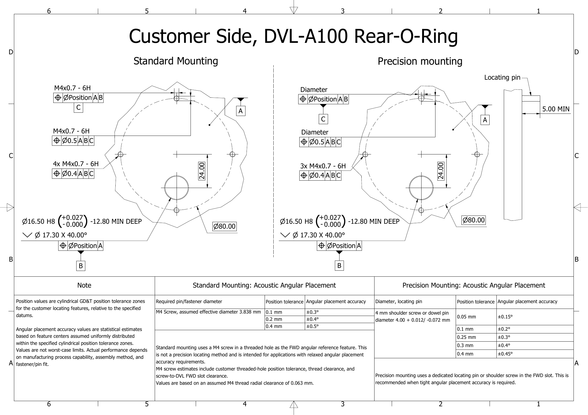
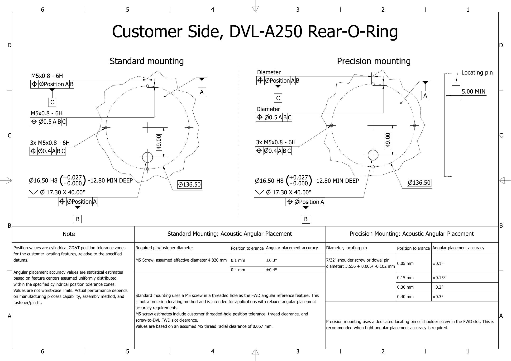

# Mounting interface (DVL A100/A250)

This page applies to the DVL A100 and DVL A250. It explains how the mounting interface sets the rotation of the DVL on your vehicle, how to choose between standard and precision mounting, and where to find the mounting interface drawing for your model.

The drawing is the reference for machining your vehicle. This page gives an overview and the main installation steps.

## Download the mounting interface drawing

| Model | Drawing | Also on |
| --- | --- | --- |
| DVL A100 | [DVL A100 mounting interface drawing (PDF, WL-21062)](https://www.waterlinked.com/web/content/139397?unique=5597169e8d073e75ffc3fbf9d39e7c823f68e866&download=true&access_token=c4317bae-e62f-4f78-8ba2-188e1fab7972) | *Downloads & Resources* on the [DVL A100 product page](https://www.waterlinked.com/shop/dvl-a100-1377) |
| DVL A250 | [DVL A250 mounting interface drawing (PDF, WL-21061)](https://www.waterlinked.com/web/content/139407?unique=665890810fa69948df7214dd54462d724ea2cfa3&download=true&access_token=09b5afbd-8fe6-4ded-b0f7-fc3bb5f165c2) | *Downloads & Resources* on the [DVL A250 product page](https://www.waterlinked.com/shop/dvl-a250-1372) |

Each drawing has three sheets:

1. **Side cable entry version:** the three through holes used to mount the side cable entry version.
2. **Rear O-ring interface version, DVL side:** the piston seal plug with its two O-rings and the FWD slot on the back plate.
3. **Rear O-ring interface version, vehicle side:** the features you machine on your vehicle, for standard and for precision mounting, with the angular placement accuracy you can expect.

## Why the mounting rotation matters

The DVL measures velocity along its own axes. If the DVL is rotated relative to the vehicle, straight travel shows up partly as sideways motion, and dead reckoning drifts sideways. A rotation of 0.1° adds about 1.7 m of sideways error per kilometre travelled, and 0.4° adds about 7 m.

A known rotation can be compensated with the mounting rotation offset, see [Axes](axes.md#vehicle-frame). A rotation caused by clearances and tolerances in the mounting interface is not known, and cannot be compensated. The mounting interface keeps this unknown rotation small.

## How the rear O-ring interface locates the DVL

On the rear O-ring interface version, two features locate the DVL on your vehicle:

* **Piston seal plug:** a Ø16.50 mm plug on the back plate with two O-rings. It fits in a bore in your vehicle, fixes the position of the DVL and seals the cable passage. The cable runs through the plug into the inside of your vehicle.
* **FWD slot:** a slot on the bolt circle, on the side marked FWD. A screw or a locating pin in this slot fixes the rotation of the DVL.

The remaining holes on the bolt circle only clamp the DVL to the vehicle.

## Choose standard or precision mounting

* **Standard mounting** uses a screw (M4 on the DVL A100, M5 on the DVL A250) in a threaded hole as the FWD reference. It needs no special parts and suits applications with relaxed accuracy requirements.
* **Precision mounting** uses a locating pin or shoulder screw in the FWD slot. Use it when the DVL must line up tightly with the vehicle forward axis.

The achievable angular placement accuracy depends on the position tolerance you machine for the bore and the FWD feature. The values from the drawings are:

| Model | Mounting | Part in the FWD slot | Position tolerance | Angular placement accuracy |
| --- | --- | --- | --- | --- |
| DVL A100 | Standard | M4 screw | Ø0.1 / 0.2 / 0.4 mm | ±0.3° / ±0.4° / ±0.5° |
| DVL A100 | Precision | 4 mm shoulder screw or dowel pin, Ø4.00 +0.012 / -0.072 mm | Ø0.05 / 0.1 / 0.25 / 0.3 / 0.4 mm | ±0.15° / ±0.2° / ±0.3° / ±0.4° / ±0.45° |
| DVL A250 | Standard | M5 screw | Ø0.1 / 0.4 mm | ±0.3° / ±0.4° |
| DVL A250 | Precision | 7/32" shoulder screw or dowel pin, Ø5.556 +0.005 / -0.102 mm | Ø0.05 / 0.15 / 0.30 / 0.40 mm | ±0.1° / ±0.15° / ±0.2° / ±0.3° |

!!! note
    The angular placement accuracy values are statistical estimates, not worst-case limits. They assume the feature centers are evenly distributed within the specified position tolerance zones. Actual performance depends on your manufacturing process, the assembly method and the fit of the pin or screw. See the drawing for the full requirements.

!!! warning "A dowel pin is a tight fit and may not enter the slot"
    To reach the stated accuracy, the pin must be very close to the width of the FWD slot, so the fit is tight by design.

    * DVL A100: the slot is 3.99 to 4.02 mm wide. A 4 mm dowel pin can be up to 4.012 mm and may not enter a slot at the narrow end of its tolerance.
    * DVL A250: the slot is 5.507 to 5.537 mm wide. A 7/32" dowel pin can be up to 5.561 mm, which is wider than the slot.

    A shoulder screw is normally made below its nominal size and fits. If a dowel pin will not go in, sand or polish it down lightly and evenly until it just enters the slot. Keep the pin round and remove no more than needed; the fit will still be tight. Do not file or widen the slot in the DVL.

The vehicle side of the interface (sheet 3 of the drawing):

=== "DVL A100"

    

=== "DVL A250"

    

## Install the DVL (rear O-ring interface)

1. Machine the mounting face of your vehicle as shown on sheet 3 of the drawing: the Ø16.50 mm H8 bore with its lead-in chamfer, the FWD feature for standard or precision mounting, and the threaded holes on the bolt circle. Keep the bore and chamfer free of scratches and burrs, as they are sealing surfaces.
2. Clean the bore and the mounting face. For precision mounting with a locating pin, fit the pin in your vehicle now.
3. Check that both O-rings on the piston seal plug are undamaged and sit correctly in their grooves. Apply a thin film of O-ring grease that is compatible with NBR.
4. Feed the cable through the bore into the vehicle.
5. Turn the DVL so the FWD mark on the back plate points at the FWD feature on your vehicle. Push the plug straight into the bore until the back plate sits flat on the mounting face. Do not use the screws to pull the plug into the bore.
6. Fit the screws and, unless you use a locating pin, the screw or shoulder screw in the FWD slot. Tighten them evenly in a cross pattern.
7. If the FWD feature is not on the forward axis of your vehicle, enter the angle as the mounting rotation offset. See [Axes](axes.md#vehicle-frame).
8. Do a [first water test](installation.md#first-water-test) before you rely on the DVL data.

!!! tip "Avoid corrosion"
    The back plate of the DVL is 316 stainless steel. Bare aluminium in contact with it corrodes in seawater. If your mounting plate is aluminium, anodise it, including the bore, and machine the bore so it is within H8 after anodising. Use screws, shoulder screws and locating pins in A4 (316) stainless steel.

!!! warning "The O-rings seal your vehicle"
    On the rear O-ring interface version, the two O-rings on the piston seal plug seal the cable passage between the surrounding water and the inside of your vehicle. Inspect them every time the DVL is removed, and replace them if they are cut, flattened or twisted. Use the O-ring specification on the drawing: ID 13.00 mm x CS 2.00 mm, NBR, 90 Shore A.

## Side cable entry version

The side cable entry version is mounted with three through holes on the bolt circle (3x Ø4.30 mm on a Ø80 mm bolt circle for the DVL A100, 3x Ø5.56 mm on a Ø136.5 mm bolt circle for the DVL A250). See sheet 1 of the drawing.

## Related pages

* [DVL A100](dvl-a100.md) and [DVL A250](dvl-a250.md) for dimensions and drawings
* [Installation](installation.md) for general mounting guidance, line of sight and vibration
* [Axes](axes.md) for the DVL body frame and the mounting rotation offset
