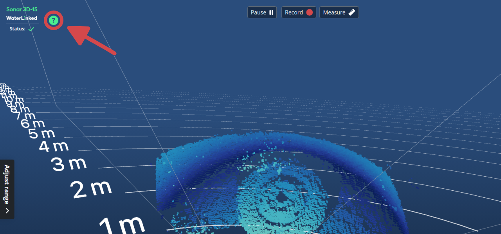

# GUI

The GUI provides a simple no-setup solution to view the Sonar 3D-15 data and change its settings.

When you first start the Sonar 3D-15 GUI you will be greeted with a view showing the 3D point cloud and various settings. To get familiar with the interface, click the { .no-card } icon (help overlay).
The 3D view can be controlled via mouse and keyboard, or touch controls.

The help overlay walks you through common features of the Sonar 3D-15 GUI.

